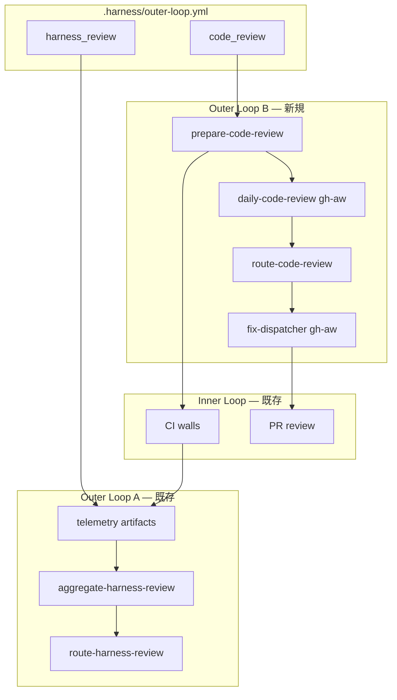
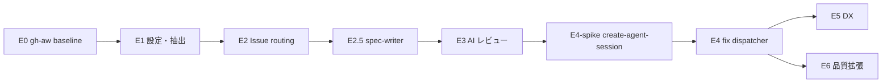
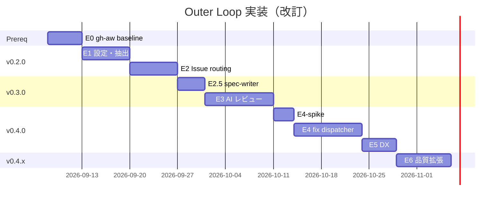

# Outer Loop 実装プラン — コード品質レビュー（改訂版）

> **Status**: draft (reviewed 2026-09-01)  
> **対象**: `@guilz-dev/sdlc-gh`  
> **関連**: [harness-extension-roadmap.md](../harness-extension-roadmap.md), [gh-aw-improvements.md](../gh-aw-improvements.md), [nightly-harness-review.md](nightly-harness-review.md)

会話およびプラン Review（2026-09-01）を反映した、汎用プロダクト向け実装計画。

## 1. ゴール

| 項目 | 内容 |
|------|------|
| **機能** | 設定ブランチ（例: `develop`）へマージされた差分を日次レビュー → finding を Issue 化 → 条件を満たせば implementer が修正 draft PR を起票 |
| **対象** | sdlc-gh を bootstrap した任意の product repo（stack 非依存） |
| **不変条件** | 壁は決定論的 / 人間ゲートは PR レビューのみ / ハーネス資産変更は eval 必須 / 自動マージなし |

### スコープ内

- 統合設定 `.harness/outer-loop.yml`（harness review + code review）
- GHA: diff 抽出・ステージング・Issue routing（dry-run デフォルト）
- gh-aw: AI レビュー・fix dispatcher（dogfood 後に schedule 化）
- npm bootstrap / wizard / doctor / `sdlc-gh status`
- シナリオテスト・prompt eval・telemetry 拡張

### スコープ外（v1）

- 自動マージ
- Sentry / Datadog 等の本番連携（`integrations` 枠のみスキーマ定義）
- `security-sensitive` finding の自動 PR
- マルチ repo 中央集約（v0.5+ で別 Epic）

---

## 2. 統合アーキテクチャ

既存 **Outer Loop A**（harness telemetry 集約）と並列で **Outer Loop B**（コード品質レビュー）を追加する。設定・morning queue・telemetry は一本化する。



### 設計原則

1. **判定は決定論** — マージ PR 収集・除外・severity フィルタ・委任可否はスクリプト
2. **AI は解釈・起草のみ** — 出力は `findings.json`（スキーマ検証必須）
3. **Issue 作成は GHA 一本化** — gh-aw の `create-issue` は使わない（二重作成防止）
4. **マージ検出の正** — `git log --merges` ではなく **GitHub API で当日マージされた PR 一覧** を正とする
5. **レビュー単位** — デフォルトは **PR 単位**；巨大 PR のみファイルチャンクに分割

---

## 3. 設定スキーマ

**新規**: `playbooks/outer-loop/schema.json`  
**例**: `playbooks/outer-loop/examples/default.yml`

```yaml
version: 1

# Outer Loop A — 既存 nightly harness review の設定化（将来）
harness_review:
  enabled: true
  window_hours: 24

code_review:
  enabled: true
  schedule: "0 18 * * *"       # 03:00 JST; promote まで workflow_dispatch のみ
  target_branch: develop       # main / develop / release/*
  window_hours: 24
  timezone: Asia/Tokyo

  merge_detection: github-api    # github-api | first-parent-git（非推奨）

  path_filter:                 # monorepo 用（空 = 全パス）
    - "src/**"

  exclude:
    paths:
      - "**/vendor/**"
      - "**/*.lock"
      - "dist/**"
      - ".github/workflows/**"   # ハーネス変更は Loop A
    labels:
      - "dependencies"
      - "renovate"
    max_diff_loc: 3000           # 超過時 PR 内でファイルチャンク分割

  review:
    categories:
      - bug-risk
      - security
      - test-gap
      - intent-drift
      - maintainability
    min_severity: medium         # issue 化の下限: low | medium | high
    max_findings_per_run: 5
    skip_if_pr_reviewed: true    # 人間レビュー済み PR は post-merge 対象外（任意）

  routing:
    dedupe_ttl_days: 7
    dry_run_default: true
    labels:
      source: outer-loop:code-review
      default_task: task:test-fix
      default_autonomy: autonomy:L1

  auto_fix:
    enabled: false               # 初期は必ず false
    max_sessions_per_run: 1
    allowed_tasks:
      - task:test-fix
      - task:docs
    max_loc: 120
    max_files: 4
    block_categories:
      - security
    min_severity: high

  cost:
    max_ai_credits_per_run: 500

# 将来: 外部監視 adapter（v1 は未実装）
integrations: []
```

---

## 4. Epic と依存関係



| Epic | リリース | ユーザー価値 |
|------|---------|-------------|
| **E0** gh-aw 前提整備 | —（内部） | 二重実行・コスト暴走の防止 |
| **E1** 設定・抽出 | v0.2.0 | 任意ブランチの日次マージ PR + diff context |
| **E2** Issue routing | v0.2.0 | finding → CC-SD Issue（dry-run デフォルト） |
| **E2.5** spec-writer | v0.3.0 | CC-SD 草案生成で L1 入口コスト削減 |
| **E3** AI レビュー | v0.3.0 | gh-aw 日次 AI レビュー（beta） |
| **E4-spike** | v0.4.0 前 | create-agent-session 実証 |
| **E4** fix dispatcher | v0.4.0 | 条件付き修正 draft PR（beta） |
| **E5** DX | v0.4.0 | wizard / status / promote |
| **E6** 品質拡張 | v0.4.x | task:bug-fix / eval / break-and-fix |

---

## E0: gh-aw 前提整備（ブロッカー）

**目的**: E3/E4 の土台。新 workflow 追加前に既存 gh-aw 負債を解消する。

| # | タスク | 成果物 |
|---|--------|--------|
| E0-1 | lock workflow の schedule 監査 | nightly/weekly が `workflow_dispatch` のみであることを CI で検証 |
| E0-2 | 共有 fragment | `.github/aw/shared/policy-guards.md`, `taxonomy.md` |
| E0-3 | frontmatter 標準 | 全 gh-aw `.md` に `engine`, `max-ai-credits`, `stop-after`, `roles` |
| E0-4 | staged inputs パターン文書化 | `docs/gh-aw-dogfood.md` に code-review 向け節追加 |

**受け入れ基準**

- [ ] `*.lock.yml` に `schedule` が無い（または `gh aw disable` 済み）
- [ ] 新規 gh-aw workflow 用 scaffold が fragment を `imports` する

**工数**: 3〜5 日

---

## E1: 設定・抽出基盤

| # | タスク | 成果物 |
|---|--------|--------|
| E1-1 | スキーマ | `playbooks/outer-loop/schema.json` |
| E1-2 | 設定ローダー | `scripts/lib/outer-loop-config.mjs` |
| E1-3 | GitHub API マージ PR 収集 | `scripts/lib/code-review-window.mjs` |
| E1-4 | PR メタ・CC-SD・CI 結果 | `scripts/lib/code-review-context.mjs` |
| E1-5 | 除外・path_filter・チャンク分割 | window lib 内 |
| E1-6 | エントリ | `scripts/prepare-code-review.mjs` |
| E1-7 | GHA workflow | `.github/workflows/daily-code-review.yml`（prepare のみ） |
| E1-8 | テスト | `scripts/test-code-review-window-scenarios.mjs` 等 |
| E1-9 | bootstrap / doctor | `bootstrap-copy.mjs`, `doctor-local.mjs` |
| E1-10 | サンプル JSON | `infra/samples/code-review-context.json` |

### マージ検出仕様

1. `gh api` で `base:{target_branch}` かつ `merged` かつ `merged_at` が window 内の PR を取得
2. 各 PR の `files` API で diff メタ取得（LOC 集計）
3. `exclude.labels` / `path_filter` / `max_diff_loc` を適用
4. 出力: `code-review/code-review-context.json` + チャンク別 patch（`/tmp/gh-aw/base/` にステージ）

**GHA permissions**: `contents: read`, `pull-requests: read`, `issues: write`, `actions: read`

**workflow_dispatch inputs**

```yaml
window_hours: "24"
target_branch: ""          # 空 = config 既定
apply_routing: false       # dry-run（既定）
```

**受け入れ基準**

- [ ] squash / merge commit 両方で当日マージ PR が取得できる
- [ ] `enabled: false` で skip
- [ ] `path_filter` で monorepo 部分パスのみ抽出
- [ ] 同日再実行で context JSON が決定論的に再現（idempotent prepare）

**工数**: 5〜7 日

---

## E2: Issue routing

| # | タスク | 成果物 |
|---|--------|--------|
| E2-1 | findings スキーマ | `playbooks/outer-loop/findings-schema.json` |
| E2-2 | 正規化・チャンク統合 | `scripts/lib/code-review-findings.mjs`（`mergeChunkFindings()`） |
| E2-3 | CC-SD 本文生成 | `scripts/lib/code-review-routing.mjs` |
| E2-4 | dedupe | `code-review-key:` マーカー（harness-routing-key と同型） |
| E2-5 | ルーティング CLI | `scripts/route-code-review.mjs` |
| E2-6 | workflow 統合 | `daily-code-review.yml` に route ステップ |
| E2-7 | ラベル | `.github/labels.yml` |
| E2-8 | テスト | `scripts/test-code-review-routing-scenarios.mjs` |
| E2-9 | 運用ドキュメント | `docs/outer-loop-code-review.md` |
| E2-10 | telemetry | `docs/telemetry-schema.md` に `source: code-review` 追加 |

### 新規ラベル

```
outer-loop:code-review
source:daily-review
severity:high | medium | low
finding:bug-risk | security | test-gap | intent-drift | maintainability
```

### finding → task マッピング（v0.2.0）

| category | task | autonomy | 自動 PR |
|----------|------|----------|---------|
| test-gap | task:test-fix | L1 | 条件付き（E4 以降） |
| bug-risk (small) | task:test-fix | L1 | 条件付き |
| intent-drift | task:docs | L1 | 条件付き |
| maintainability | task:refactor | L0 | 不可 |
| security | task:security-sensitive | L0 | 不可 |

### 環境変数

- `CODE_REVIEW_ROUTING_DRY_RUN=1`（既定）— nightly の `HARNESS_ROUTING_DRY_RUN` と同型
- 出力: `code-review/code-review-routing-plan.json`, `code-review-routing-results.json`

**受け入れ基準**

- [ ] fixture `findings.json` → CC-SD Issue 作成
- [ ] dedupe / update（同一 `code-review-key`）
- [ ] `min_severity` / `max_findings_per_run` 遵守
- [ ] dry-run で Issue 未作成・plan JSON のみ
- [ ] 既存 nightly harness review に回帰なし

**工数**: 5〜7 日

**v0.2.0 对外メッセージ**: *「Outer loop foundation」* — AI なしでも prepare + fixture routing + dry-run で検証可能

---

## E2.5: spec-writer

| # | タスク | 成果物 |
|---|--------|--------|
| E2.5-1 | gh-aw workflow | `.github/workflows/spec-writer.md` |
| E2.5-2 | `/spec` コマンド | issue 本文に CC-SD 草案追記 |
| E2.5-3 | dogfood 登録 | `GH_AW_SOURCE_WORKFLOWS` |

**受け入れ基準**

- [ ] finding Issue に `/spec` で CC-SD 5 フィールドが埋まる
- [ ] `issue-spec-check` が通る草案品質（prompt eval で最低ライン定義）

**工数**: 3〜4 日

---

## E3: AI レビュー

**依存**: E0 完了、E2 完了

| # | タスク | 成果物 |
|---|--------|--------|
| E3-1 | エージェント | `.github/agents/code-reviewer.agent.md` |
| E3-2 | gh-aw source | `.github/workflows/daily-code-review.md` |
| E3-3 | lock + dogfood | `.lock.yml`, `gh-aw-dogfood.mjs` 拡張 |
| E3-4 | GHA 連携 | prepare → gh-aw（dispatch）→ route |
| E3-5 | prompt eval | `prompts/code-reviewer-classify.prompt.yml` |
| E3-6 | サンプル | `infra/samples/code-review-findings.json` |

### gh-aw safe-outputs（v1）

```yaml
safe-outputs:
  create-issue:
    max: 0    # Issue は GHA route のみ
```

エージェントは `findings.json` を artifact / staged path に出力。GHA が schema 検証後に route。

**受け入れ基準**

- [ ] `gh aw compile` 成功
- [ ] dogfood 3 連続 green（promote 前は `workflow_dispatch` のみ）
- [ ] findings が schema をパース可能
- [ ] prompt eval 最低 accuracy を PR ゲートで定義

**工数**: 7〜10 日

---

## E4-spike: create-agent-session 実証

**目的**: E4 着手前に最大リスクを検証。

| 手順 | 内容 |
|------|------|
| 1 | 手動で CC-SD 完備の `task:test-fix` Issue を 1 件作成 |
| 2 | gh-aw `fix-dispatcher.md` プロトタイプで `create-agent-session` を 1 回 |
| 3 | draft PR が `target_branch` を base に生成されるか確認 |
| 4 | 失敗時は E4 を「手動 implementer assign」フォールバックで v0.4.0 リリース |

**受け入れ基準**

- [ ] spike 結果を `docs/outer-loop-code-review.md` に記録（成功 / 失敗 / 制約）

**工数**: 2〜3 日

---

## E4: fix dispatcher

**依存**: E4-spike 成功（失敗時は Issue のみモードで v0.4.0）

| # | タスク | 成果物 |
|---|--------|--------|
| E4-1 | 委任ポリシー | `scripts/lib/fix-dispatch-policy.mjs` |
| E4-2 | gh-aw dispatcher | `.github/workflows/fix-dispatcher.md` |
| E4-3 | トリガ | `issues: labeled`（`source:daily-review` + task + autonomy） |
| E4-4 | telemetry | `emit-telemetry-artifact.mjs`, `aggregate-harness-review.mjs` 拡張 |
| E4-5 | テスト | `scripts/test-fix-dispatch-policy-scenarios.mjs` |

### 自動委任条件（すべて必須）

```
auto_fix.enabled == true
severity >= auto_fix.min_severity
task ∈ allowed_tasks
category ∉ block_categories
推定 LOC ≤ max_loc && files ≤ max_files
同一 code-review-key で dedupe_ttl 内に PR なし
security-sensitive ラベルなし
```

**受け入れ基準**

- [ ] 条件合致で `create-agent-session` が max 回以内
- [ ] draft PR + CI green を目指すが自動マージなし
- [ ] 不合致は Issue コメントで理由明示

**工数**: 7〜10 日（spike 結果に依存）

---

## E5: DX・運用

| # | タスク | 成果物 |
|---|--------|--------|
| E5-1 | wizard | `--enable-outer-loop` / `--enable-code-review` |
| E5-2 | `sdlc-gh status` | harness + code-review の morning queue 統合 |
| E5-3 | `sdlc-gh promote daily-code-review` | dogfood criteria → schedule 有効化 PR 雛形 |
| E5-4 | adoption Phase 6 | `docs/adoption.md` |
| E5-5 | arch 図更新 | `docs/arch.md` Outer Loop B |
| E5-6 | morning queue | `docs/operations.md` 統合チェックリスト |
| E5-7 | revert | `docs/revert-playbook.md` に `enabled: false` 手順 |
| E5-8 | Copilot 注意 | adoption に「全 diff を AI に送る」旨 |

**工数**: 4〜5 日

---

## E6: 品質拡張（v0.4.x）

| # | タスク | 成果物 |
|---|--------|--------|
| E6-1 | `task:bug-fix` | labels, AGENTS.md, task.yml, issue-spec |
| E6-2 | failure-taxonomy | コード品質 finding カテゴリ |
| E6-3 | break-and-fix eval | `evals/e2e-bench/tasks/code-review-fix.yml` |
| E6-4 | integration adapters 枠 | `playbooks/outer-loop/integrations/README.md` |

**工数**: 5〜8 日

---

## 5. ファイル一覧

### 新規

```text
playbooks/outer-loop/
├── schema.json
├── findings-schema.json
├── examples/default.yml
└── integrations/README.md

scripts/lib/
├── outer-loop-config.mjs
├── code-review-window.mjs
├── code-review-context.mjs
├── code-review-findings.mjs
├── code-review-routing.mjs
└── fix-dispatch-policy.mjs

scripts/
├── prepare-code-review.mjs
├── route-code-review.mjs
└── test-code-review-*.mjs
└── test-fix-dispatch-policy-scenarios.mjs

.github/
├── workflows/daily-code-review.yml
├── workflows/daily-code-review.md
├── workflows/fix-dispatcher.md
├── workflows/spec-writer.md
├── agents/code-reviewer.agent.md
└── aw/shared/policy-guards.md, taxonomy.md

docs/outer-loop-code-review.md
infra/samples/code-review-context.json
infra/samples/code-review-findings.json
```

### 修正

```text
.github/labels.yml
AGENTS.md
docs/operations.md
docs/adoption.md
docs/arch.md
docs/telemetry-schema.md
docs/failure-taxonomy.md
docs/gh-aw-dogfood.md
scripts/lib/gh-aw-dogfood.mjs
scripts/lib/bootstrap-copy.mjs
scripts/bootstrap-harness.sh
scripts/sdlc-gh-cli.mjs
scripts/setup-wizard.mjs
scripts/lib/doctor-local.mjs
scripts/check-issue-spec.mjs  # E6
harness-extension-roadmap.md
package.json
README.md  # docs table
```

---

## 6. PR 分割（実装順）

| PR | Epic | 内容 |
|----|------|------|
| PR-0 | E0 | gh-aw baseline + shared fragments |
| PR-1 | E1 | schema + outer-loop-config + examples |
| PR-2 | E1 | code-review-window + context + tests |
| PR-3 | E1 | prepare-code-review + daily-code-review.yml（prepare） |
| PR-4 | E2 | routing lib + route CLI + labels + tests |
| PR-5 | E2 | workflow route 統合 + docs + **v0.2.0** |
| PR-6 | E2.5 | spec-writer |
| PR-7 | E3 | code-reviewer agent + gh-aw md + dogfood |
| PR-8 | E4-spike | create-agent-session 検証記録 |
| PR-9 | E4 | fix-dispatcher + policy |
| PR-10 | E5 | wizard / status / promote + **v0.4.0** |
| PR-11 | E6 | bug-fix + eval（v0.4.x） |

---

## 7. リリース計画

| バージョン | Epic | npm tag | 説明 |
|-----------|------|---------|------|
| **v0.2.0** | E0+E1+E2 | `latest` | Outer loop foundation（dry-run Issue routing） |
| **v0.3.0** | E2.5+E3 | `latest` | Daily code review beta（AI dispatch） |
| **v0.4.0** | E4+E5 | `latest` | Auto-fix draft PR beta |
| **v0.4.x** | E6 | `latest` | bug-fix タスク・eval |



**総工数見積もり**: 約 43〜59 日（1 FTE）

---

## 8. 採用者ロールアウト

### Phase A — 観察（v0.2.0）

```yaml
code_review:
  enabled: true
  routing:
    dry_run_default: true
  auto_fix:
    enabled: false
```

1〜2 週間、`workflow_dispatch` + `apply_routing: false` で plan JSON のみ確認。

### Phase B — Issue 化（v0.2.0 後半）

- `apply_routing: true` で Issue 作成開始
- precision 人手評価（20 件以上、目標 > 70%）

### Phase C — AI レビュー（v0.3.0）

- gh-aw `workflow_dispatch`
- dogfood 3 連続 green → `sdlc-gh promote daily-code-review`

### Phase D — 半自動修正（v0.4.0）

```yaml
auto_fix:
  enabled: true
  max_sessions_per_run: 1
  allowed_tasks: [task:test-fix]
  min_severity: high
```

---

## 9. テスト戦略

| 層 | 対象 |
|----|------|
| Unit scenario | window, context, findings merge, routing, dispatch policy |
| Fixture JSON | `infra/samples/*` + `gh api` モック注入 |
| Regression | 既存 `test-harness-review-*` 非破壊 |
| Convention | `evals/trajectories/test_harness_conventions.py` |
| Prompt eval | code-reviewer 分類（最低 accuracy を PR ゲート化） |
| Dogfood | compile, safe-outputs, scope |
| Pilot | 1 repo × 1 週間、precision / CI green 率 |

---

## 10. 成功指標（KPI）

### v0.2.0

- [ ] bootstrap + `doctor --strict` pass
- [ ] 任意 `target_branch` で context JSON 生成
- [ ] fixture routing 100% 成功
- [ ] nightly harness review 回帰なし

### v0.3.0

- [ ] AI findings が schema パース可能
- [ ] dogfood 3 連続 green
- [ ] pilot precision > 70%（n ≥ 20）

### v0.4.0

- [ ] E4-spike 記録あり
- [ ] 自動 draft PR の CI green 率 > 60%
- [ ] 自動マージ 0 件
- [ ] `enabled: false` で即停止確認済み

---

## 11. リスクと緩和

| リスク | 緩和 |
|--------|------|
| gh-aw 二重実行 | E0 で lock schedule 監査；新 workflow は dispatch のみ直到 promote |
| create-agent-session 未実証 | E4-spike；失敗時は手動委任で v0.4.0 |
| 誤検知 | dry-run 先行、max_findings、min_severity |
| チャンク文脈欠落 | PR 単位デフォルト；`mergeChunkFindings()` |
| PR レビューとの重複 | `skip_if_pr_reviewed`、post-merge のみ |
| monorepo コスト | `path_filter` 必須 |
| CC-SD 空洞化 | E2.5 spec-writer + issue-spec-check |
| 同日再実行 | idempotent prepare；dedupe key で Issue 更新 |

---

## 12. 次のアクション

1. **PR-0**（E0）から着手
2. sdlc-gh 自身に `.harness/outer-loop.yml` を置き dogfood
3. v0.2.0 は *foundation* として publish；first usable は v0.3.0 と明記

---

## 改訂履歴

| 日付 | 変更 |
|------|------|
| 2026-09-01 | 初版（会話ベース） |
| 2026-09-01 | Review 反映: E0/E2.5/E4-spike 追加、GitHub API マージ検出、dry-run、統合設定、工数・リリース再定義 |
